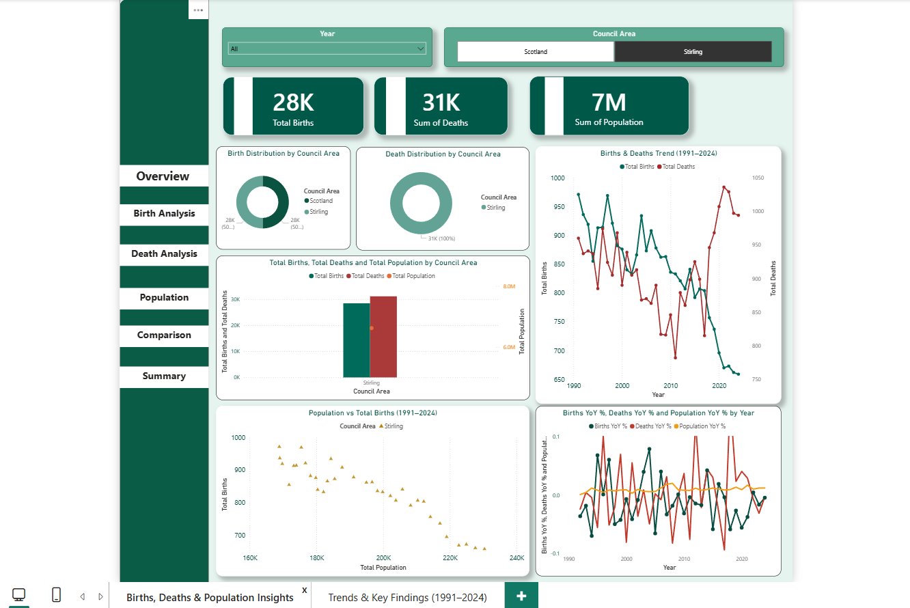
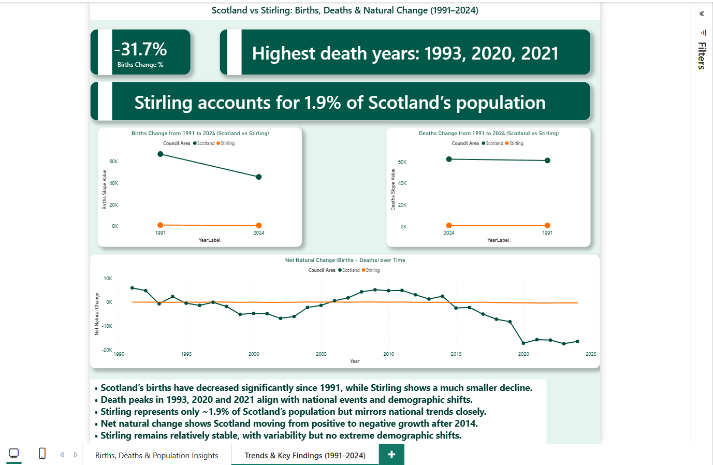
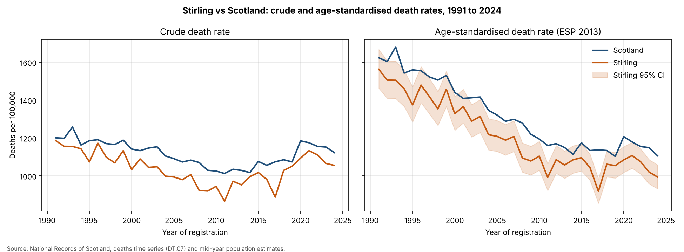

# 📊 Stirling Births–Deaths–Population Insights Dashboard (1991–2024)

A complete demographic analysis dashboard comparing Scotland vs Stirling over 34 years, focusing on births, deaths, population trends, natural change, and long-term demographic shifts.

---

## 🟢 Project Title / Headline  
### **Stirling vs Scotland: Births, Deaths & Population Change Dashboard (1991–2024)**

An interactive Power BI report designed to reveal demographic patterns, highlight key population indicators, and support evidence-based regional insights.

---

## 📌 1. Short Description / Purpose

The **Stirling Births–Deaths–Population Dashboard** provides a clear, visually driven comparison of Scotland and Stirling across major demographic indicators.  
It helps analysts, policymakers, researchers, and students understand how population dynamics have evolved over time and identify the causes behind major demographic changes.

---

## 🧰 2. Tech Stack

This dashboard was created using:

- 📊 **Power BI Desktop** — data modelling, DAX, report development  
- 🔄 **Power Query** — data cleaning, merging, transformations  
- 🧠 **DAX (Data Analysis Expressions)** — YoY calculations, slope metrics, custom KPIs  
- 🗂 **Data Modelling** — linking births, deaths, population, DimYear, DimCouncil  
- 📁 **File Formats** — `.pbix` (report), `.csv` / `.xlsx` (data), `.png` (screenshots)  
- 🐍 **Python (pandas, SciPy, Matplotlib)** — age-standardised death rates, confidence intervals and validation checks

---

## 📚 3. Data Source

**Source:** National Records of Scotland (NRS)  
**Time Period:** 1991–2024  

### Includes:
✔ Annual Births  
✔ Annual Deaths  
✔ Total Population  
✔ Scotland vs Stirling comparison  
✔ Deaths by age group and population by single year of age (for age standardisation)  

### Data Files:
- `births_timeseries_scotland_1855_2024.xlsx`  
- `deaths-time-series-24-corrected.xlsx`  
- `population_1991_2024.csv`  

---

## ⭐ 4. Features / Highlights

### 🔍 Business Problem

Local governments, researchers, and analysts often struggle to compare regional population trends in a clear, data-driven way.  
Key questions such as:

- How have births changed over the last 30+ years?  
- Did pandemic years significantly impact deaths?  
- How different is Stirling from the national demographic pattern?  
- When did Scotland move into negative natural change?  

---

### 🎯 Goal of the Dashboard

To provide an intuitive, interactive visual tool that:

✔ Tracks long-term demographic patterns  
✔ Compares Stirling vs Scotland  
✔ Identifies peaks, declines, and demographic shifts  
✔ Highlights natural population change  
✔ Supports decision-making for research, planning, and public policy  

---

### 📊 Walkthrough of Key Visuals

#### 1️⃣ Insight Cards (Top Section)

- Births Change % (1991–2024): **−31.7%**  
- Highest Death Years: **1993, 2020, 2021**  
- Stirling’s Population Share: **~1.9% of Scotland**

#### 2️⃣ Births & Deaths Distribution (Donut Charts)

Shows the share of births and deaths between Scotland and Stirling.

#### 3️⃣ Births & Deaths Trend (Line Chart)

Tracks the movement of births and deaths over time, with peaks around **1993**, **2003**, and **2021**.

#### 4️⃣ Population Trend (1991–2024)

Visualises the slow but steady growth in Scotland’s population.

#### 5️⃣ Births vs Population (Scatter Chart)

Helps identify whether rising population aligns with birth growth (it **does not**).

#### 6️⃣ YoY % Change Analysis

Compares **Births YoY %**, **Deaths YoY %**, and **Population YoY %**.

#### 7️⃣ Slope Charts (Storytelling Page)

- Births: **1991 vs 2024**  
- Deaths: **1991 vs 2024**  

Provides a clear before–after view of long-term direction.

#### 8️⃣ Net Natural Change (Births − Deaths)

Reveals Scotland’s shift from **positive** to **negative** natural change after **2014**.

---

### 💡 Business Impact & Insights

- 📉 Scotland’s births decreased sharply from the early 1990s — a major demographic challenge.  
- 🩺 Death peaks in 1993, 2020 and 2021 align with population health events.  
- 📍 Stirling trends mirror national trends, despite being only ~1.9% of the total population.  
- 🔄 Natural population change is now negative, driven mainly by falling births.  
- 🧭 Useful for policy planning, resource allocation, demographic forecasting, and academic analysis.  

---

## 🖼️ 5. Dashboard Previews

#### 📊 Births, Deaths & Population Overview

#### 📈 Trends & Key Findings (1991–2024)

---

## 📐 6. Age-Standardised Death Rates

Crude death rates can mislead when comparing areas, or the same area over time, because they depend on how old the population is. This extension calculates **directly age-standardised death rates** so Stirling and Scotland can be compared fairly.

### Method
- Deaths by 10-year age group (NRS Table DT.07) and mid-year population estimates by single year of age
- Weighted to the **2013 European Standard Population**, summed into the same 10-year age groups
- Rates per 100,000 with **95% confidence intervals** (Dobson method)
- Script: `age_standardised_death_rates.py` → output `Data/age_standardised_death_rates.csv`

### Quality checks
1. Crude rates match NRS published death rates (Table DT.09) exactly
2. Stirling's rate relative to Scotland agrees with NRS standardised mortality ratios (Table DT.11) within 1.5 points in every year from 2000 to 2024
3. Using 10-year age groups instead of the full 5-year standard changes Scotland's rate by 1.1% at most

### Key findings
- 📉 Scotland's crude death rate fell only **6.5%** from 1991 to 2024, but the age-standardised rate fell **31.8%**: an ageing population hid most of the improvement
- 📍 Stirling's age-standardised rate was **significantly lower** than Scotland's in **26 of 34 years** (994 vs 1,106 per 100,000 in 2024)
- 🔍 Standardising widens the gap, because Stirling's population is older than Scotland's

### Limitations
- Deaths are counted by year of registration, not year of death
- NRS publishes council deaths only in 10-year age groups
- 12 deaths with age not stated are excluded
- Stirling's smaller numbers give wider confidence intervals, so single-year dips (such as 2017) should be read with caution

---

## 👤 8. Author

**Rohan Thube**  
_Data & Business Analyst | Power BI | Python | SQL_  
📍 **United Kingdom**

🔗 **LinkedIn:** https://www.linkedin.com/in/rohan-thube-423403239/  
📧 **Email:** thuberaj@gmail.com
